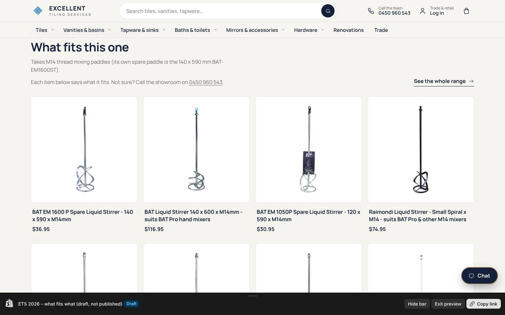
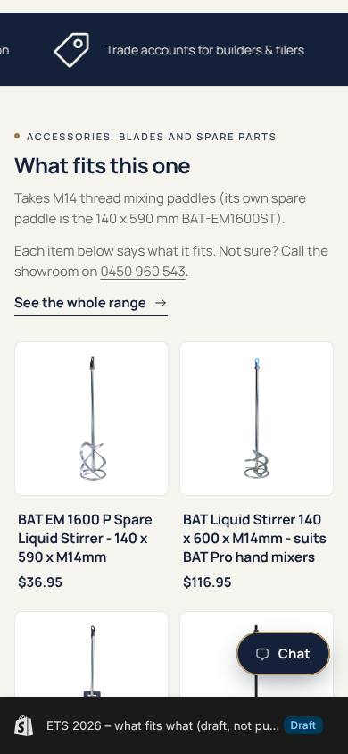
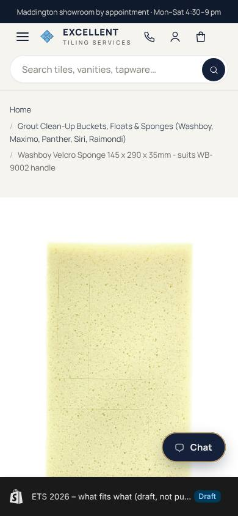
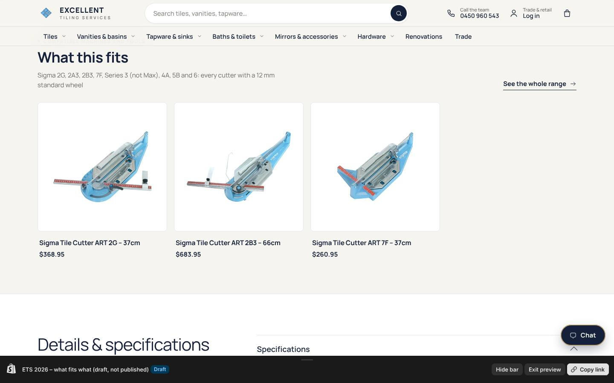
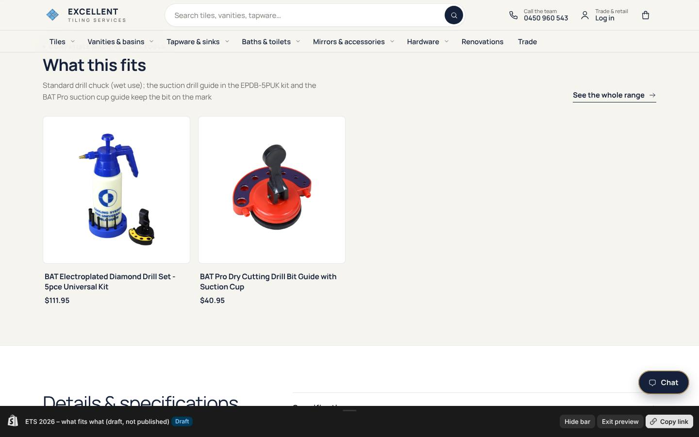
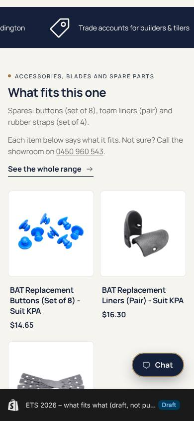
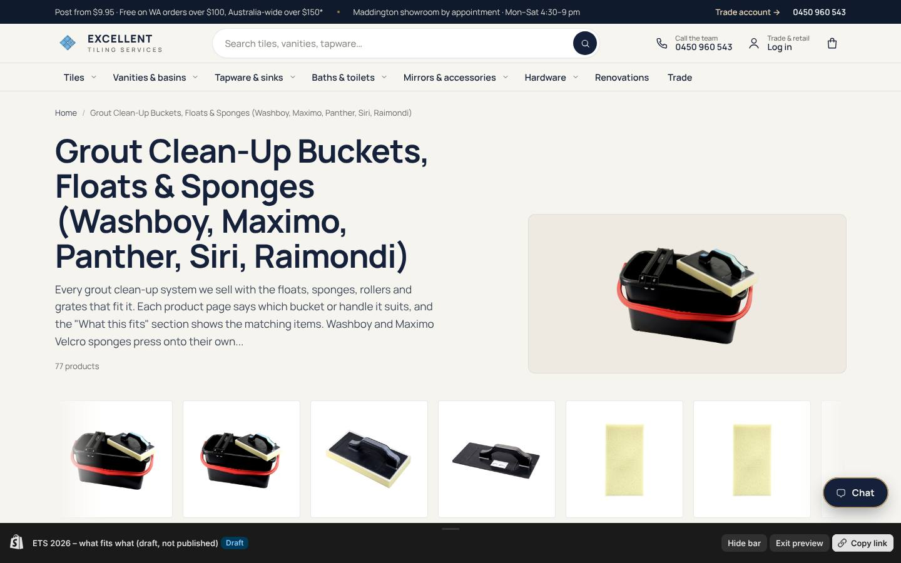
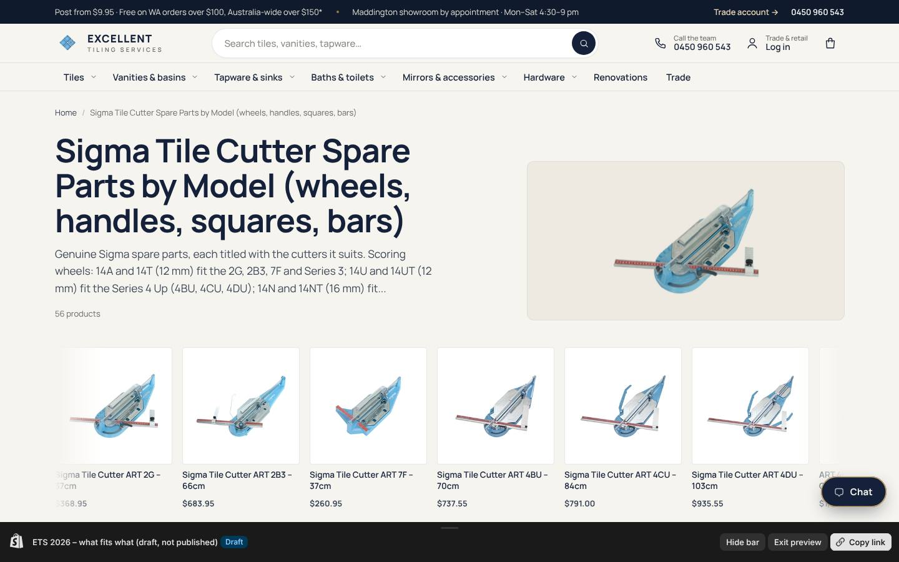

# Catalogue check and "what fits what" for the whole tool range (12 Oct 2026)

Customer feedback on 12 Oct: it is hard to tell which items work with which. The owner photographed the
BAT Trims Tools Catalogue (books ONE to SIX, 106 pages) and every tool product in the store was checked
against it. This follows the Raimondi-only pass earlier the same day
(`raimondi-fit-2026-10-12.md`) and extends it to BAT, Washboy, Panther, Siri, Sigma, Baron, Atika,
Maxisil and Barwalt.

## What was checked

- The catalogue was transcribed in full: 774 rows in `store-content/catalogue/bat-tools-catalogue.csv`.
- Every stocked tool product was matched to its catalogue code (BAT 184 of 325 catalogue items stocked,
  Raimondi 164 of 319, Washboy 10 of 26, ADA 2 of 4). Sigma is stocked under the Roberts codes (56
  products), so the catalogue's cutter pages and parts diagrams were used for the facts rather than the codes.
- Titles, descriptions, sizes and "suits" statements were compared row by row, and a store-wide map of what
  fits what was built: 370 products, in `store-content/catalogue/compatibility-all.csv`.

## What changed on the live store

- 71 titles now say what they suit (for example "Washboy Velcro Sponge 145 x 290 x 35mm - suits WB-9002
  handle", "Sigma Spare Wheel with axle ART14A 12mm - suits 2G, 2B3, 7F & Series 3", "BAT Replacement Paint
  Roller Cover 230mm - Set of 3 - suits 230mm roller frames").
- 186 descriptions open with a bold "Fits:" line (parts, sponges, blades, paddles) or carry a "What fits:"
  line (machines, buckets, guns, frames). No links in descriptions, because eBay copies them.
- 55 product types corrected: Sigma spares were typed as "Tile Cutters" (now "Tiling Machine Parts"),
  Sigma suction cups are "Suction Cups & Lifters", the Sigma 63E/63G tables are "Large Format Tile
  Handling", BAT nippers, knives and grout removers are "Tiling Tools" instead of cutters.
- Every one of the 370 products carries `ets.fits_with`, `ets.fits_models` and the new `ets.fits_role`
  (parent or item), which the theme uses for its headings.
- Eight new collections, published and linked from the Raimondi, BAT, Sigma and Panther brand pages:
  grout clean-up buckets, floats and sponges (77 products, five brands together); mixers, paddles and
  buckets (37); Sigma spare parts by model (56); scrapers, grout removers, knives and blades (30);
  silicone guns, applicators and nozzles (22); knee pads and spares (14); tile drilling (10); Washboy (9).
- The BAT Pro 250/300/350 mm wet-saw blades and the brass reducing bushes were added to the Raimondi
  wet-saw accessories collection, since they fit the Zoe, SMS and SA 80.

## Facts the catalogue corrected

- **Bi-Bulldog** (both listings): the store said it came with a 10 mm radius shaping wheel. The catalogue
  lists it supplied without profiling wheels. Pages now say the wheels are sold separately.
- **Bulldog manual feed kit** (RAI-BULLMFK) fits the Bulldog only; the Bi-Bulldog takes its own kit
  (RAI-BIBULLMFK, to order). The page said it fitted both.
- **Bulldog connecting piece** (RAI-BULLCP) joins Bulldog and Bi-Bulldog machines in line; the page said it
  connected the Back-Finisher to the Bulldog.
- **Zoe Advanced** takes 300, 350 or 360 mm blades (360 mm cuts 120 mm deep). The SMS and SA 80 pages now
  also list the BAT Pro 300 and 350 mm blades that fit them.
- **SA 80** optional extras exist to order: extension side square, adjustable square, foot pedal and
  extension bench (RAI-ESSSA80, RAI-SSSA80, RAI-FPSA80, RAI-EBSA80).
- **Raimondi epoxy grout floats** are 115 x 250 mm with soft blue or hard green rubber; the slant ridge
  trowel is titled "Raimondi Stainless Steel Slant Ridge Trowel".
- **RV175 battery suction cup** also fits the Levtop Plus and the Easymove frames.
- **Washboy**: the WB-9002 handle (130 x 265 mm) takes the 145 x 290 mm sponge; the large 185 x 345 mm
  sponge needs the WB-9002L handle; sponge titles now carry the catalogue sizes; the hand sponge is
  165 x 110 x 65 mm.
- **BAT trowels**: the stainless square notch range is 4, 6, 8, 10 and 15 mm (no 12 mm); the bright steel
  range is 4 to 15 mm (the stray "halfmoon" word is gone).
- **BAT screed bars**: the 4200 and 5000 mm bars have double handles.
- **BAT LS liquid stirrers** have a 10 mm hex shaft for a drill chuck, not an M14 thread.
- **BAT mesh turbo blade** comes in 105 and 115 mm; the KPA buttons are a set of 8.
- **Sigma wheels**: 14A/14T (12 mm) fit the 2G, 2A3, 2B3, 7F, Series 3 (not Max), 4A, 5B and 6;
  14U/14UT (12 mm) fit the Series 4 Up; 14N/14NT (16 mm) fit the Series 4 NEX; 14MX (19 mm) fits the
  Series 3 Max; 14C (15 mm) fits the 2D4 and Klick Klock models. Handles, squares and bars are titled with
  the cutters they suit.

## For the owner to decide

1. **Bi-Bulldog**: the catalogue says no profiling wheels are included. If BAT actually ships one with it,
   say so and the pages go back to "supplied with a 10 mm wheel".
2. **BAT Pro 1050 W mixer**: the page says "13mm drill chuck" but its spare paddle (BAT-EM1050ST) is M14.
   The page now also says "Takes M14 thread mixing paddles". If the 1050 W really has a chuck, the spare
   paddle line needs changing instead.
3. **Washboy large handle**: the store sells the large 185 x 345 mm sponge (WB-9003L) but not the
   WB-9002L handle it needs. Either stock the handle or add "handle to order" to the sponge page.
4. **Menu**: the eight system collections are reachable from product pages and brand pages. If you want
   them in the Hardware dropdown, say which ones.

## Catalogue items not stocked (for ordering decisions)

- Raimondi: 155 catalogue items, including the Exploit, Bolt and Mistral wet saws, Pikus Advanced saws,
  CM150/CM180 and Maxi-Cut bridge saws, Bulldog tile tables and automation kits, SA 80 extras, Raimondi
  drill bits and guides, RLS clip packs beyond the stocked sizes, Free-Cut rails and Easy-Move 3000.
- Sigma: 24 items, including the 2A3, 3G, 3L, Series 3 Max, 4A, 5B and 6 cutters, the 9M1/10M9 wet saws
  and the Sigma core drills.
- Marcrist drilling (22), Unitec blades (24), Battipav X-Pro cutters and parts (13), Kaufmann Topline
  cutters and parts (6), Bostik glue guns and sticks (3), ADA lasers (2), Atika Compact mixers (1).
- Washboy: 16 items, including the large float, handle and sponges (WB-9001L, WB-9002L, WB-9006, WB-9007),
  the epoxy and polyester sponges, the 23 L bucket, dirt catcher, grate and roller sets.
- BAT: 141 of 325 catalogue items, mostly size and colour variants of stocked ranges (straight edges,
  levels, spacer packs, nails, trowel sizes) plus BATSEAL Smooth, Prime and Clean.

## The theme

The owner deleted his copy of the live theme this evening, which also removed the Raimondi "what fits"
section. A fresh duplicate of the live theme was made through the API (publishing stays with the owner):
**"ETS 2026 – what fits what (draft, not published)"**, gid://shopify/OnlineStoreTheme/144033579071. It has
the section, the snippet and both product templates; nothing else differs from the live theme. Headings:
"What fits this one" on machines and tools, "What this fits" on parts, with a "See the whole range" link to
the product's system collection.

Preview (works while the draft exists):
https://excellenttilingservice.com.au/products/bat-pro-electric-hand-mixer-1600w?preview_theme_id=144033579071

To publish: Shopify admin, Online Store, Themes, find "ETS 2026 – what fits what", the three dots, Publish.

Checked on desktop (1440 px) and phone (390 px) for a BAT mixer, a Washboy sponge, a Sigma spare wheel, a
drill bit, knee pads and three collection pages: no Liquid errors, cards and links present on every page.
