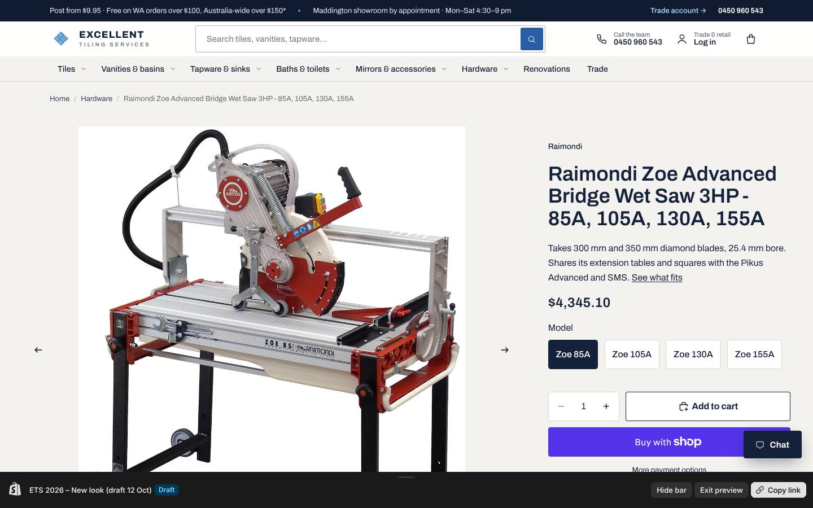
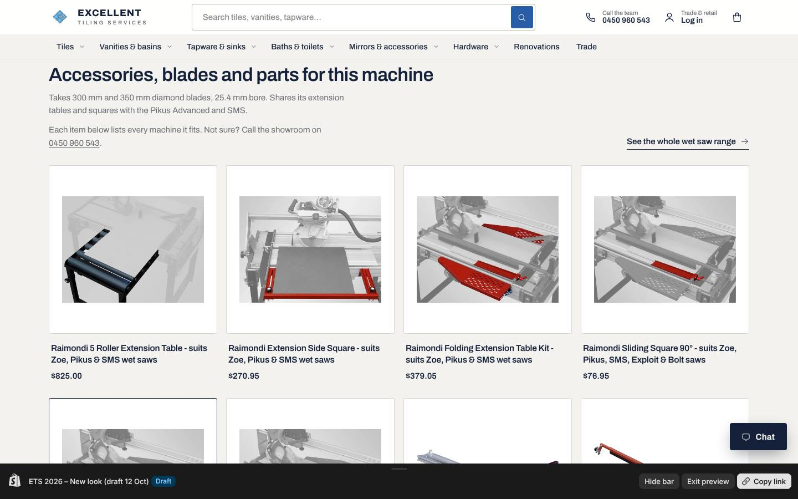
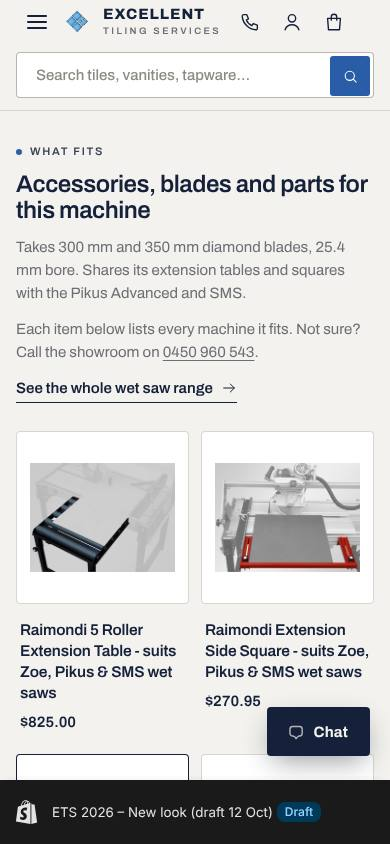
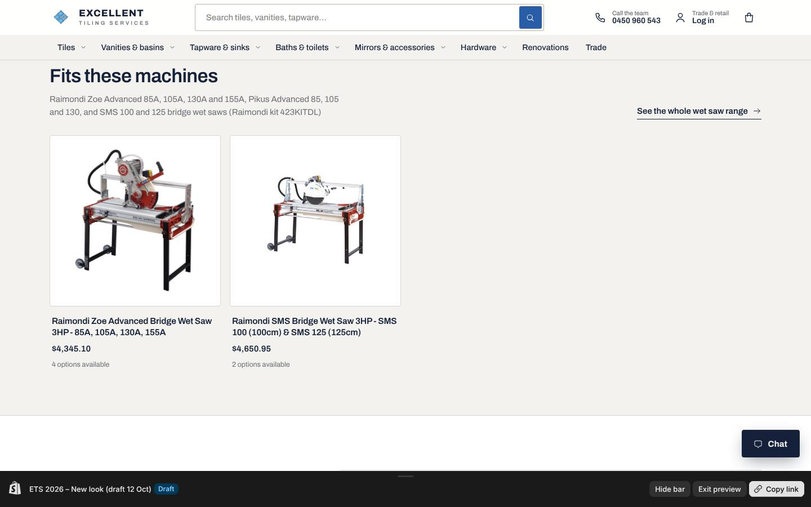
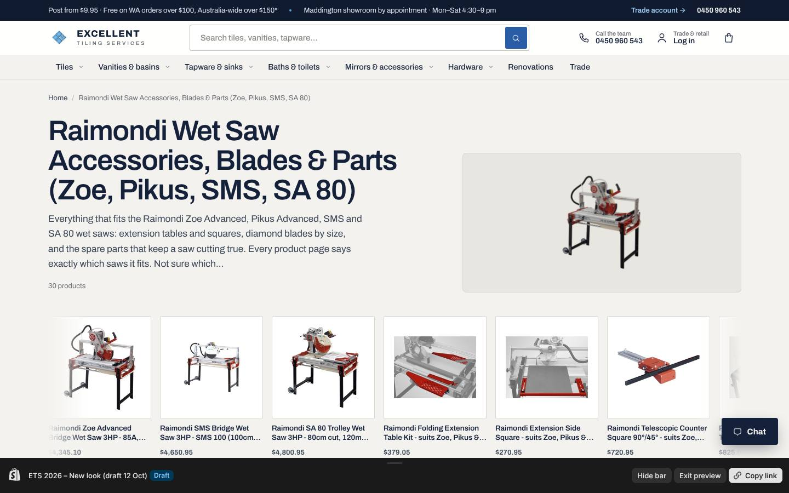

# Raimondi: what fits what (12 Oct 2026)

Order #1009 today (Zoe 85A, folding extension table, extension side square, 3 + 3 buckets of Double
spacers, $4,962 by PayID, pickup) was hard work for the customer: the Zoe page did not say which accessories
fit it, the extension table was titled "suit Pikus", and nothing linked the saw to its blades and parts.

## What was wrong

- The Zoe page said "350mm diamond blade" and "up to 110mm thick in a single pass". Raimondi's current page
  says it ships with a 300 mm blade, cuts 80 mm deep with a 300 mm blade and 110 mm with a 350 mm blade.
- The folding extension table was "Raimondi Folding Extension Table" with the handle `…-suit-pikus`.
  Raimondi's chart (kit 423KITDL) lists every Zoe Advanced, Pikus Advanced and SMS.
- The "Wheels & Handle Kit" said it was for Raimondi wet saws. It is Raimondi 315CR02K for the Exploit, Bolt
  and Mistral; the Zoe, Pikus, SMS and SA 80 come with a wheel kit, so a Zoe owner should not buy it.
- The tile holding device variant "Pikus/Zoe 130A" also fits the SMS 125 (423BL130ADV).
- Blades, parts and squares said "suits Pikus, Zoe and SMS" in the text but not in the title, and the saw
  pages listed none of them.

## What changed on the live store today

- 31 product pages rewritten (the three saws, 8 accessories, 5 spare parts, 13 blades, the Double spacer):
  titles now say what they suit, descriptions open with a bold "Fits:" line, the saws end with "What fits
  this saw", search titles and descriptions updated. Facts come from Raimondi's catalogue and website; the
  Raimondi article numbers are quoted so a customer can check against the Raimondi manual. No prices changed.
- Every Raimondi machine, accessory, blade and spare part (131 products) now carries `ets.fits_with`
  (the products it fits, or that fit it) and `ets.fits_models` (the models in plain words).
- Seven "shop by machine" collections, published and linked from the Raimondi collection:
  wet saws (Zoe, Pikus, SMS, SA 80: 30 products), Bulldog (14), Raizor (15), grout clean-up (35),
  Ipertitina and Maxititina (24), mixers and vibrators (17), Easymove and Bigfoot (15).

## What shows once the new look is published

The draft theme (ETS 2026 – New look) has a new "what fits" section on every product page and a "Fits:" line
under the title. The live theme does not have it, so until the owner publishes the draft the compatibility
shows as text in the descriptions and through the collections.

Preview: https://excellenttilingservice.com.au/products/raimondi-zoe-electric-wet-saw-3hp?preview_theme_id=144026435647

## For the owner

- Zoe in the box: Raimondi's site says a 300 mm porcelain blade is standard now (their 2021 catalogue said
  350 mm). The page says 300 mm. If BAT ships a 350 mm blade, tell me and I will change it.
- Order #1009 margins (sale price vs cost inc GST): Zoe 85A $4,060 vs $3,839 (5.4% kept); extension table
  $340 vs $286 (16%); side square $240 vs $198 (18%); spacers $55.96 vs $47.30 and $51.96 vs $44 (15%).
  Everything sold above cost. The Zoe went out at 6.6% under the website price.
- Full map and sources: `store-content/raimondi/README.md` and `compatibility.csv`.
